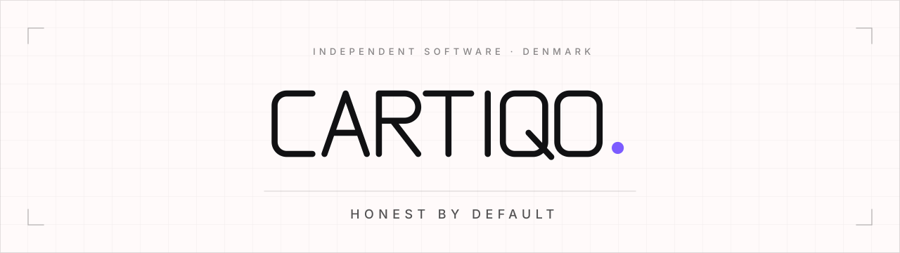

<picture>
  <source media="(prefers-color-scheme: dark)" srcset="https://raw.githubusercontent.com/cartiqolabs/.github/main/profile/assets/banner-dark.svg">
  
</picture>

 

   

**CARTIQO Labs is an independent software studio in Denmark.** We design, build and run CARTIQO software ourselves, and the people who write the code are the people who answer your questions.

Everything we make is on [cartiqolabs.com](https://cartiqolabs.com).

## What we stand for

- **Honest by default.** Clear prices in euro. Paid plans add things; they never lock away the free core.
- **Your data is yours.** We don't sell it.
- **Hosted in the EU.**
- **Real support.** You talk to the people who build it, not a script.

## Get in touch

| | |
| --- | --- |
| Website | [cartiqolabs.com](https://cartiqolabs.com) |
| Help and feedback | The [CARTIQO Discord](https://discord.gg/A6b4bTTaeJ): ask a question, report a bug or tell us what to build next |
| Email | [support@cartiqo.app](mailto:support@cartiqo.app) |

## Brand kit

- [Banners, logos and icons](https://cartiqolabs.github.io/.github/): makes CARTIQO banners in the sizes GitHub, Discord, X, LinkedIn and YouTube want, the CARTIQO wordmark, rank cards, and icons from the open-source Lucide set on a CARTIQO shape.
- [@cartiqo/brand](https://github.com/cartiqolabs/.github/tree/main/packages/brand#readme): the same banners, logos and rank cards from JavaScript, the command line or an HTTP API.

## Open source

What we open up lives in [CartiqoFramework](https://github.com/CartiqoFramework).
